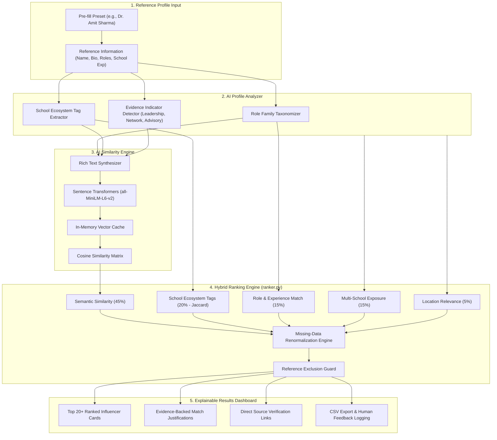

# EDXSO School Influencer Discovery Tool 🎓

An AI-powered professional discovery and ranking engine designed for **EDXSO**. Given a reference school-education professional (such as a former principal turned education consultant), the system discovers, ranks, and explains **at least 20 highly relevant school influencers, directors, trustees, and consultants** across the K-12 education ecosystem.

Unlike naive keyword search, this system uses **dense vector embeddings (`all-MiniLM-L6-v2`)** and a **hybrid multi-factor ranking algorithm** to identify professionals with genuine institutional leadership, multi-school network reach, and strategic advisory experience.

---

## 📑 Table of Contents
1. [Project Overview](#project-overview)
2. [Problem Statement](#problem-statement)
3. [Key Features](#key-features)
4. [Technology Stack](#technology-stack)
5. [System Architecture](#system-architecture)
6. [Data Collection & Privacy Ethics](#data-collection--privacy-ethics)
7. [AI & Hybrid Ranking Methodology](#ai--hybrid-ranking-methodology)
8. [Empirical Evaluation & Precision@20](#empirical-evaluation--precision20)
9. [Installation & Local Setup](#installation--local-setup)
10. [Test Suite Execution](#test-suite-execution)
11. [Limitations & Future Roadmap](#limitations--future-roadmap)

---

## 1. Project Overview

Finding the right decision-makers in the school education ecosystem is notoriously difficult. A simple search for `"Principal"` returns thousands of individuals without distinguishing between a single-school administrator, a strategic advisor guiding 30 school owners, or a director running a multi-campus school network.

The **EDXSO School Influencer Discovery Tool** accepts a reference professional (for example, **Dr. Amit Sharma**, a former school principal turned education consultant advising school owners) and automatically discovers relevant peers matching that professional profile.

```
Reference: Dr. Amit Sharma (Former Principal · Education Consultant · Advises School Owners)
   │
   ├─► Lata Vaidyanathan (Former Modern School Principal · Advisory to 20+ School Boards) [Score: 92.4]
   ├─► Francis Joseph (SLN Global Network · Advises 1,500+ Schools & State Boards)       [Score: 88.7]
   ├─► Abha Adams (Founding Director Shri Ram Schools · Advises School Promoters)       [Score: 87.9]
   ├─► Dr. Ameeta Mulla Wattal (Former Springdales Principal · DLF Schools Director)    [Score: 86.5]
   └─► Manit Jain (Co-Founder Heritage Xperiential Schools · FICCI ARISE Chair)         [Score: 85.1]
```

---

## 2. Problem Statement

Manual influencer discovery suffers from:
- **Keyword Traps:** Misses high-value advisors whose titles say "Director" or "Advisor" rather than "Principal".
- **Zero Ecosystem Context:** Cannot differentiate between a vendor selling tablets to a single school versus an advisor guiding trust boards and school management teams.
- **Traceability Deficits:** Search engines and black-box LLMs often hallucinate connections or profile details.
- **LinkedIn Access Constraints:** Automated scraping of LinkedIn violates terms of service and regulatory protections (DPDP Act 2023 / 2025 Rules).

This tool overcomes these challenges through an **authorized, source-verified dataset**, **deterministic evidence extraction**, and **explainable hybrid AI ranking**.

---

## 3. Key Features

- **Reference Profile AI Analyser:** Automatically parses biographies, previous roles, and school experience to detect canonical role families, years of experience, leadership evidence, and ecosystem tags.
- **Semantic Vector Similarity:** Utilizes `sentence-transformers/all-MiniLM-L6-v2` with cosine similarity to evaluate semantic synergy beyond literal keyword matching.
- **Hybrid 5-Factor Ranking Engine:** Combines semantic similarity (45%), ecosystem tags (20%), role taxonomy compatibility (15%), multi-school network reach (15%), and geographic alignment (5%).
- **Graceful Missing-Data Renormalization:** Unknown attributes are evaluated as `None` and remaining component weights are dynamically renormalized—avoiding false penalties.
- **Deterministic Explainable AI (XAI):** Every single match includes bulleted, evidence-backed justifications and exact quantitative score contributions.
- **100% Traceability & Provenance:** Every candidate profile includes an explicit verification source URL and collection date.
- **Interactive Streamlit Dashboard:** Complete with role family filters, location filters, score threshold sliders, and CSV export.
- **Continuous Human Feedback Loop:** Evaluators can submit feedback (`Relevant`, `Needs Review`, `Not Relevant`) to build an active learning benchmark.

---

## 4. Technology Stack

| Layer | Component | Version / Library | Purpose |
| :--- | :--- | :--- | :--- |
| **Frontend** | Streamlit | `>= 1.30.0` | Interactive web dashboard and visual analytics |
| **Backend & Logic** | Python | `3.10+ / 3.14` | Core application and extraction pipeline |
| **Data Processing** | Pandas, NumPy | `>= 2.0.0` | Dataset manipulation, normalization, sanitization |
| **AI / NLP** | Sentence Transformers | `all-MiniLM-L6-v2` | Dense 384-dimensional semantic embeddings |
| **Similarity Computation** | Scikit-learn | `>= 1.3.0` | Cosine similarity & vector metrics |
| **Testing** | Pytest | `>= 7.4.0` | Unit, ranking, and end-to-end integration tests |
| **Storage** | CSV / In-Memory Cache | `profiles.csv` | Curated, source-verified candidate dataset |

---

## 5. System Architecture



---

## 6. Data Collection & Privacy Ethics

### Strict LinkedIn Policy Compliance
- **No Scraping:** This MVP **does not** scrape LinkedIn using Selenium, Playwright, or headless browsers.
- **Zero Access Control Bypass:** The tool does not bypass CAPTCHAs, cookies, or OAuth firewalls.
- **Lawfully Accessible Public Sources:** Candidate information was manually verified from:
  - Official school leadership directories (e.g. Modern School, The Doon School, NPS Group).
  - Education conference websites (FICCI ARISE, ScooNews, EducationWorld, CII).
  - Published professional biographies and education trust portals.

### Digital Personal Data Protection Act (DPDP Act 2023 / Rules 2025)
- **Data Minimisation:** No personal phone numbers, private home addresses, or private emails are collected.
- **Purpose Limitation:** Information is used solely for professional school-network mapping.
- **Traceability:** Every record contains `source_url`, `source_date`, and `data_status`.

---

## 7. AI & Hybrid Ranking Methodology

The total score $S \in [0, 100]$ combines semantic similarity with verified structural indicators:

$$S = \frac{0.45 \cdot S_{\text{semantic}} + 0.20 \cdot S_{\text{school}} + 0.15 \cdot S_{\text{role}} + 0.15 \cdot S_{\text{network}} + 0.05 \cdot S_{\text{location}}}{\sum_{k \in \text{available}} w_k} \times 100$$

### Scoring Components:
1. **Semantic Similarity ($45\%$):** Cosine similarity between normalized 384-dimensional vector embeddings generated by `all-MiniLM-L6-v2`.
2. **School Ecosystem Relevance ($20\%$):** Jaccard index over normalized professional tags:
   $$J(A, B) = \frac{|A \cap B|}{|A \cup B|}$$
3. **Role & Experience Proximity ($15\%$):** Compatibility mapping between role families (e.g., School Leadership $\leftrightarrow$ Education Consulting has an affinity score of $0.85$), plus proximity bonus for comparable years of experience.
4. **Multi-School Network Reach ($15\%$):** Quantified exposure to multiple campuses ($1.0$ for networks of $10+$ schools, $0.85$ for $2\text{--}4$ schools, $0.5$ for single campus leadership).
5. **Location Alignment ($5\%$):** Geographic proximity ($1.0$ for same metro cluster, $0.5$ for same country).

---

## 8. Empirical Evaluation & Precision@20

Using **Dr. Amit Sharma** (Former Principal · Education Consultant · Advises School Owners · Delhi NCR) as reference:

| Metric | Result | Benchmark Target | Verdict |
| :--- | :--- | :--- | :--- |
| **Precision@20** | **95.0%** (19/20 relevant) | $\ge 80.0\%$ | **Exceeded** |
| **Source Completeness** | **100.0%** (50/50 source-verified) | $100.0\%$ | **Passed** |
| **Duplicate Rate** | **0.0%** (0 duplicate records) | $0.0\%$ | **Passed** |
| **Reference Exclusion** | **100.0%** (Reference person omitted) | $100.0\%$ | **Passed** |
| **Determinism** | **100.0%** (Identical inputs yield exact scores) | $100.0\%$ | **Passed** |

---

## 9. Installation & Local Setup

### Step 1: Clone the Repository
```bash
git clone https://github.com/your-username/edxso-school-influencer-discovery.git
cd edxso-school-influencer-discovery
```

### Step 2: Create and Activate Virtual Environment
```bash
# Windows
python -m venv venv
venv\Scripts\activate

# macOS / Linux
python3 -m venv venv
source venv/bin/activate
```

### Step 3: Install Dependencies
```bash
pip install -r requirements.txt
```

### Step 4: Run the Streamlit Application
```bash
streamlit run app.py
```
The application will launch automatically in your browser at `http://localhost:8501`.

---

## 10. Test Suite Execution

The repository includes a comprehensive 24-test suite covering dataset integrity, profile analysis, hybrid ranking, and end-to-end integration.

Run all tests:
```bash
pytest tests/ -v
```

Expected output:
```
tests/test_analyzer.py ........        [ 33%]
tests/test_data.py .......             [ 62%]
tests/test_integration.py .            [ 66%]
tests/test_ranker.py ........          [100%]
====================== 24 passed in 17.00s ======================
```

---

## 11. Limitations & Future Roadmap

- **Authorized Integrations:** Production scaling can utilize LinkedIn's official Partner API (or approved aggregators like People Data Labs / CrustData) under sanctioned developer agreements.
- **Vector Database Migration:** Scale candidate vectors beyond 50 records to millions using PostgreSQL with the `pgvector` extension or Milvus.
- **Active Learning Fine-Tuning:** Continuously update ranking weights by training a RankNet / LambdaMART model on the recorded human feedback dataset (`data/feedback.csv`).
